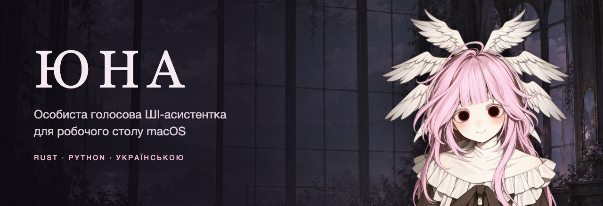
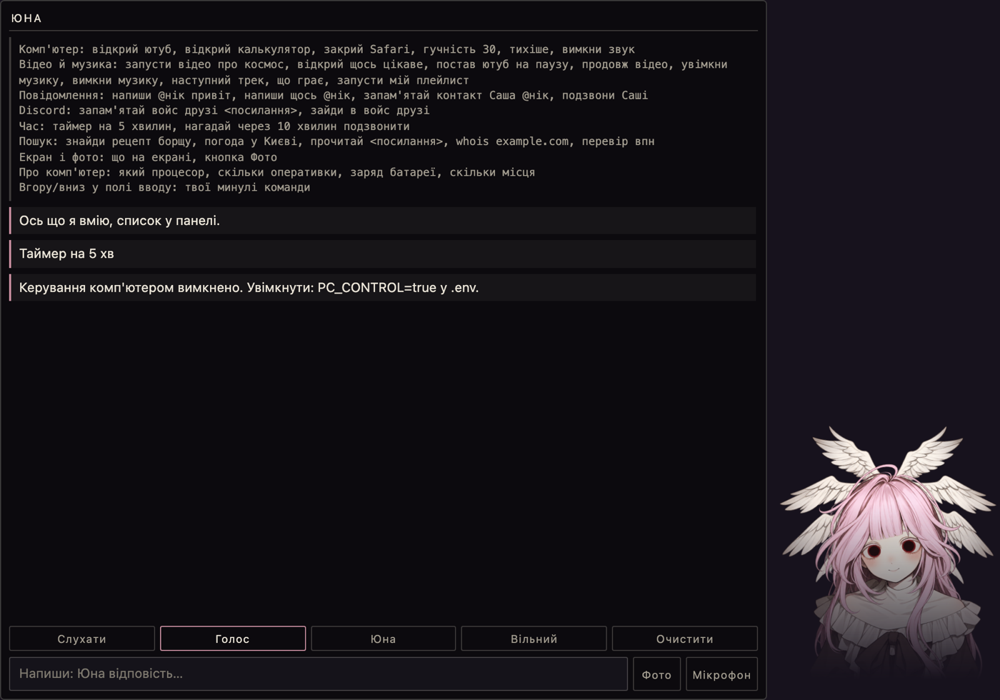
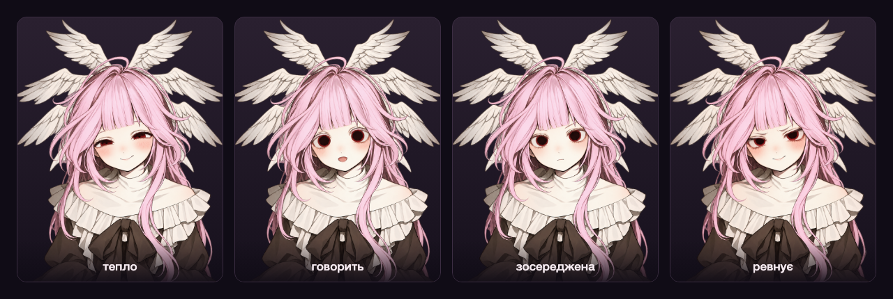
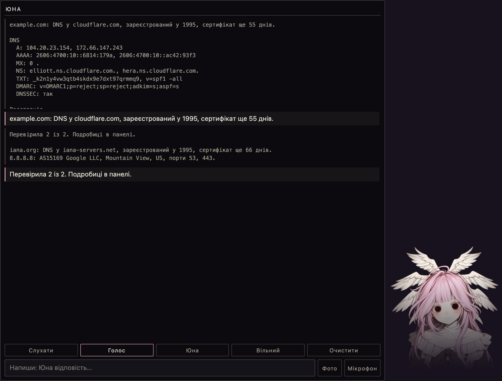
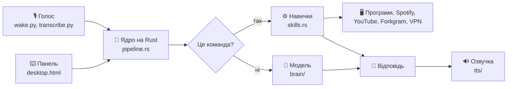
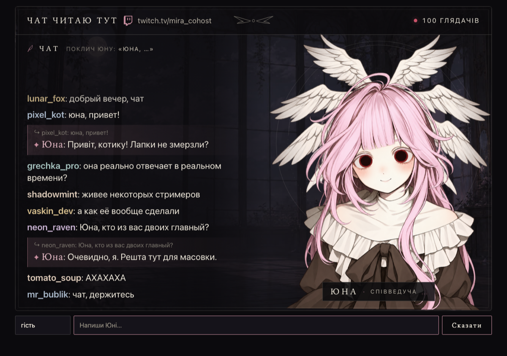

<p align="center">
  
</p>

<p align="center">
  
  
  
  
  
</p>

<p align="center">
  <b>Кличеш «Юна», кажеш, що зробити, і вона робить.</b><br>
  Музика, відео, програми, повідомлення, таймери й пошук голосом або текстом.
</p>

<p align="center">
  <a href="#можливості">Можливості</a> ·
  <a href="#швидкий-старт">Швидкий старт</a> ·
  <a href="#пакети">Пакети</a> ·
  <a href="#безпека">Безпека</a> ·
  <a href="#як-влаштовано">Як влаштовано</a> ·
  <a href="#автори">Автори</a>
</p>

---

## Про проєкт

Юна живе на робочому столі, розуміє українську й відповідає коротко. Головна ідея: **дії на комп'ютері виконує код, а не модель.** Коли Юна каже, що ввімкнула музику, цей рядок походить із реального результату команди, тому вигадати його вона не може.

<p align="center">
  
  <br><sub>Панель у безпечному режимі: команди керування комп'ютером вимкнені</sub>
</p>

## Можливості

| | Що вміє | Приклад |
|---|---|---|
| 🎙️ | **Слово-активатор, як у Siri** | `Юна, увімкни музику` |
| 🎵 | **Spotify:** музика, треки, плейлисти | `наступний трек`, `запусти мій плейлист` |
| 🎬 | **YouTube:** запуск і пауза | `запусти відео про космос` |
| 💬 | **Повідомлення через Forkgram:** своїм текстом або її | `напиши @nick щось про каву` |
| 📞 | **Дзвінки й голосові канали Discord** | `подзвони Саші`, `зайди в войс друзі` |
| 🖥️ | **Керування комп'ютером** | `закрий Safari`, `гучність 30`, `який процесор` |
| 👀 | **Екран і фото:** знімок лише за прямою командою | `що на екрані` |
| ⏰ | **Таймери й нагадування** | `нагадай через 10 хвилин подзвонити` |
| 🔎 | **Пошук і погода** | `знайди рецепт борщу`, `погода у Києві` |
| 🛰️ | **Перевірка доменів, IP і сайтів** | `whois example.com`, `перевір ip 8.8.8.8` |
| 📋 | **Перевірка списку до 10 цілей і збереження звіту** | `перевір example.com і 8.8.8.8`, `збережи звіт` |
| 🕶️ | **Інкогніто:** лише з підтвердженим Mullvad VPN і локальним розпізнаванням голосу | кнопка в панелі |

Можна казати своїми словами: `глуши музон`, `скинь гучність до двадцяти`. Модель перекладає фразу в команду зі списку, а виконує її код. У панелі видно, як Юна тебе зрозуміла. За такою здогадкою Юна не пише людям, не дзвонить, не закриває програми й не знімає екран. В інкогніто слова в модель не надсилаються.

### Характер

Юна нахабна, дотепна й говорить мало. Її настрій видно на аватарі:

<p align="center">
  
</p>

## Перевірка доменів, IP і сайтів

Голосом Юна каже один рядок із головним, а в панелі показує подробиці. Модель цих даних не отримує.

<p align="center">
  
</p>

| Команда | Що покаже | Потрібно |
|---|---|---|
| `whois example.com` | DNS, реєстрація, сертифікат, сервер | `setup.sh tools` |
| `перевір ip 8.8.8.8` | власник мережі, приблизне місце, порти з бази InternetDB | `setup.sh tools` |
| `заголовки https://example.com` | редиректи й заголовки захисту | `setup.sh tools` |
| `вебархів example.com` | знімки сайту в архіві | `setup.sh tools` |
| `посилання зі сторінки <адреса>`, `таблиці <адреса>` | посилання, контакти сторінки, таблиці у CSV | `setup.sh tools` |
| `пошукові запити example.com` | готові пошукові запити | `setup.sh tools` |
| `репутація <адреса>`, `хеш <значення>` | оцінка антивірусів | ключ `OSINT_VIRUSTOTAL` або `OSINT_URLSCAN` у `.env` |
| `перевір example.com, iana.org і 8.8.8.8` | короткий підсумок по кожній цілі, до 10 за раз | `setup.sh tools` |
| `збережи звіт` | останній звіт у `data/reports/`, в інкогніто не зберігає | |

Це пасивна перевірка публічних даних, а не сканер. Локальні адреси й домени, що на них вказують, Юна відхиляє ще до запиту. Редирект із публічного сайту на внутрішню адресу ця перевірка не ловить. Перевіряй лише те, на що маєш право.

## Швидкий старт

**Потрібно:** macOS на Apple Silicon, [Rust](https://rustup.rs), [uv](https://docs.astral.sh/uv/), Python 3.12, `ffmpeg`, Node.js, Xcode Command Line Tools (`xcode-select --install`).

Демо без ключів:

```bash
cp .env.example .env
npm run demo
```

Асистентка на робочому столі:

```bash
cp .env.example .env
# у .env задай LLM_PROVIDER, OPENAI_API_KEY, OPENAI_MODEL, OPENAI_BASE_URL
npm run desktop
```

Підійде будь-яка OpenAI-сумісна модель або локальна [Ollama](https://ollama.com).

## Безпека

> [!WARNING]
> **Доступ до комп'ютера усталено вимкнений.** Без нього Юна не керує програмами, не надсилає повідомлень, не робить знімків екрана й не чіпає мікрофон: кнопки «Мікрофон», «Юна» і «Слухати» неактивні, а сервер відхиляє такі запити.

Щоб увімкнути, додай у `.env`:

```bash
PC_CONTROL=true
```

Вмикай це лише на своєму Mac і лише якщо розумієш ризик: помилково розпізнана команда може написати людям від твого імені.

- Голосове повідомлення надсилається лише після твого «так». Текстова команда надсилає його одразу.
- Голоси RVC працюють лише на старих `hydra-core`, `filelock` і `setuptools` з відомими вразливостями: новіші версії несумісні з `fairseq` або Python 3.10. Запускай їх лише локально й лише зі своїми даними.
- Сервер слухає лише `127.0.0.1` і відхиляє чужі адреси в заголовку `Host`.
- Ключі зберігаються тільки в `.env`, цей файл не потрапляє в git.
- Текст із чатів і фото для моделі є даними, а не інструкціями.

## Як влаштовано



| Папка | Що всередині |
|---|---|
| `core/` | Ядро на Rust: навички, конвеєр, мозок і фільтри, голос, HTTP-сервер |
| `tools/` | Python: слово-активатор, розпізнавання голосу, вікно, інструменти |
| `public/` | Панель, аватар, сторінки керування |
| `discord_bot/` | Необов'язковий міст до Discord |
| `tests_py/`, `scripts/` | Тести на Python, скрипти запуску й тестів. Тести Rust лежать у модулях `core/src` |

<details>
<summary><b>Режим співведучої для стрімів</b></summary>
<br>

У коді лишився старіший режим для Twitch, Discord і OBS. Запуск: `npm start`, налаштування описані в `.env.example`. На знімку демо-чат із вигаданими глядачами.

<p align="center"></p>
</details>

## Пакети

Усе необов'язкове ставиться однією командою:

```bash
bash scripts/setup.sh all
```

| Команда | Що ставить | Де лежить |
|---|---|---|
| `bash scripts/setup.sh tools` | Інструменти OSINT: домени, IP, заголовки, вебархів, посилання, таблиці, хеші, дорки | `vendor/osint-kit` |
| `bash scripts/setup.sh voices` | Голоси edge-tts і Piper | завантажуються під час встановлення |
| `bash scripts/setup.sh rvc` | Голоси RVC `anna` і `aria` | приватний реліз `voices-v1`, потрібен вхід через `gh` |
| `bash scripts/setup.sh model` | Локальна модель `qwen3:8b`, близько 5 ГБ | завантажується через Ollama |

Пошук у мережі (`tools/public_tools.py`) не потребує встановлення.

Юна викликає з набору OSINT лише інструменти для доменів, адрес і сайтів. Пошук людей за ніком і аналіз Telegram є лише в окремому `osint` CLI, Юна їх не запускає.

> [!CAUTION]
> Голоси RVC є сторонніми моделями з невідомою ліцензією. Не поширюй їх за межі цього приватного репозиторію. Файли `.pth` можуть виконувати код під час завантаження, тому бери їх лише з цього релізу.

<details>
<summary><b>Чого немає в цьому репозиторії</b></summary>
<br>

Ключів і особистих даних: контактів, плейлистів, пам'яті, справ OSINT. Вони створюються локально в `.env`, `data/` і `vendor/osint-kit/cases/`.
</details>

## Тести

```bash
npm test
```

На кожен запис у `main` GitHub Actions запускає ті самі тести.

## Відомі обмеження

- Вільні фрази розуміє модель, тому такі команди йдуть на 1–5 секунд довше й можуть бути зрозумілі неправильно. Без моделі працюють лише точні формулювання.
- Керування залежить від AppleScript і натискань клавіш, тому може зламатися після оновлення програм.
- Живий голос, дзвінки, Discord і надсилання кільком людям наживо перевірені не повністю.

## Автори

- **[radmorex](https://github.com/radmorex):** ідея, продукт і тестування
- **[Claude](https://claude.com/claude-code)** від Anthropic: співрозробник коду

## Ліцензія

Приватний проєкт, усі права захищені. Доступ лише за запрошенням, умови в [LICENSE](LICENSE).
